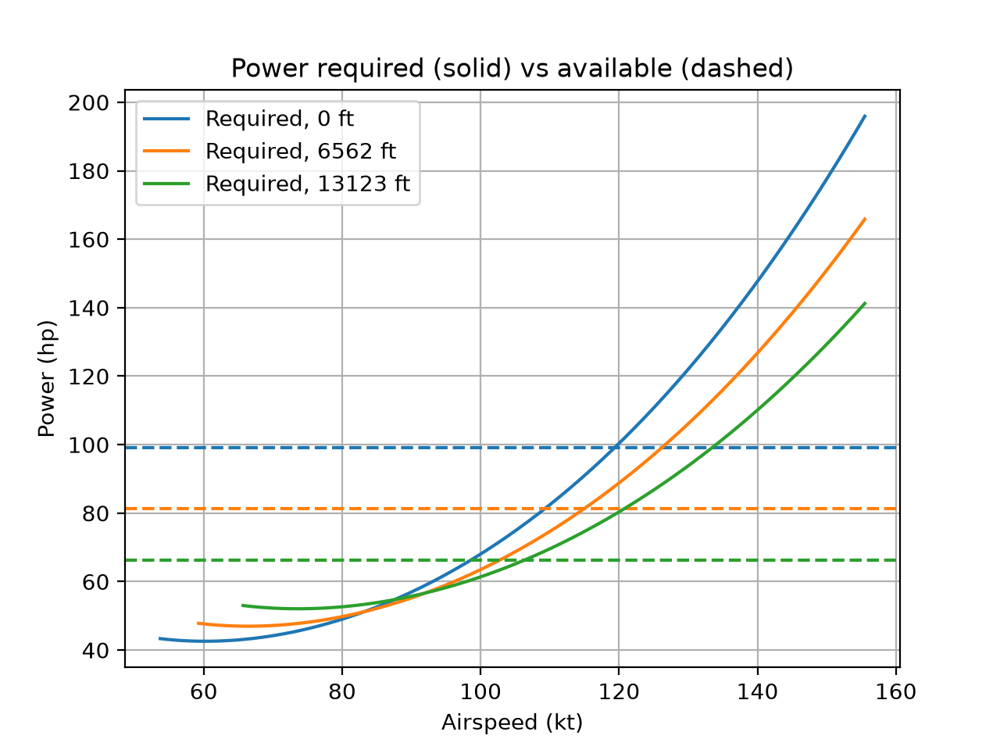
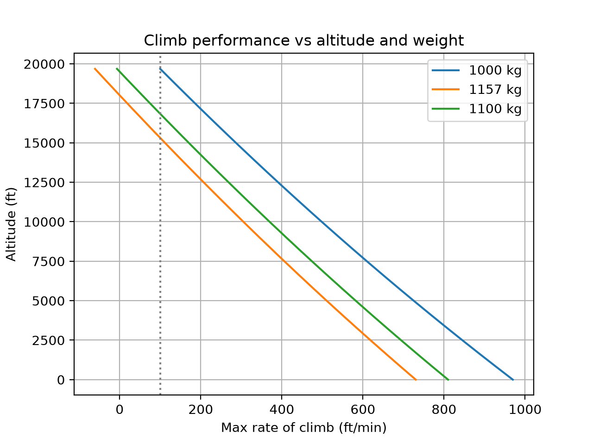
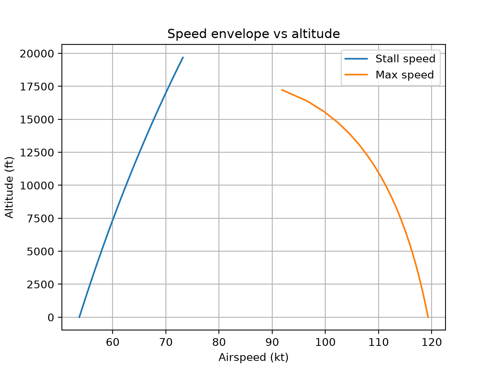

# Cessna 172S Performance Simulator

A Python model of Cessna 172S performance, built from first principles
(ISA atmosphere, drag polar, propeller power model) and validated
against published POH data.

## What it computes
- Stall speed, maximum speed, rate of climb, service ceiling
- Maximum range and endurance (propeller Breguet equations)
- Sweeps across altitude, weight, and airspeed

## Results





## Validation against POH (after tuning)

```
Quantity                           Model       POH   Error %
Stall speed, clean (kt)             53.7      51.0      +5.3
Max speed, sea level (kt)          119.3     126.0      -5.3
Max climb rate, SL (ft/min)        730.3     730.0      +0.0
Service ceiling (ft)             15311.0   14000.0      +9.4
Max range w/ reserve (nm)          619.6     638.0      -2.9
```

Propeller efficiency was tuned to match sea-level climb rate.
Service ceiling and range were not tuned, so they serve as an
independent check. See `report/report.md` for full discussion.

## Run it
```
pip install -r requirements.txt
python -m pytest
python -m src.validate
python -m scripts.run_sweep
```

## Structure
- `src/atmosphere.py`: ISA model
- `src/aircraft.py`: 172S parameters
- `src/aero.py`: drag polar, L/D
- `src/propulsion.py`: power and thrust available
- `src/performance.py`: stall, speed, climb, ceiling, range, endurance
- `src/validate.py`: comparison against POH data
- `scripts/`: sweep/plot and tuning scripts
- `tests/`: unit tests

## Limitations
- Constant effective propeller efficiency
- Simple density-ratio engine power lapse
- Constant BSFC, clean configuration only, no ground effect