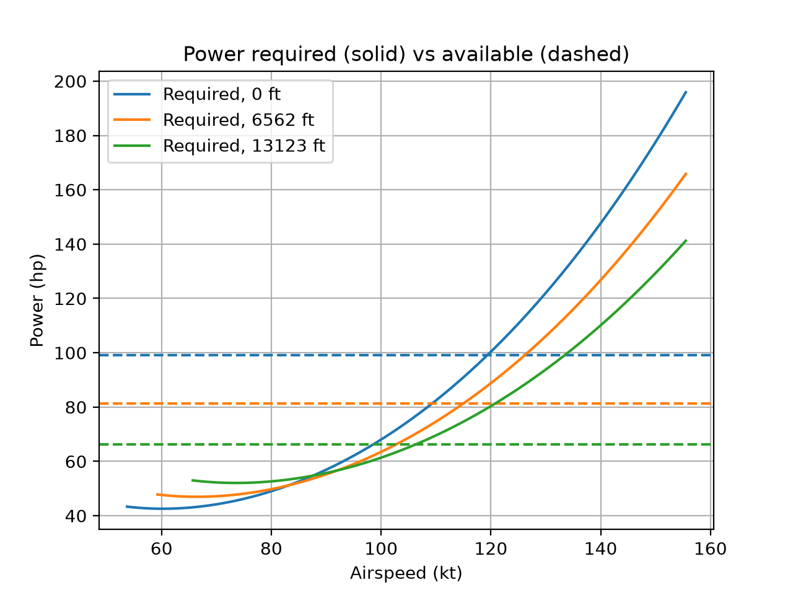
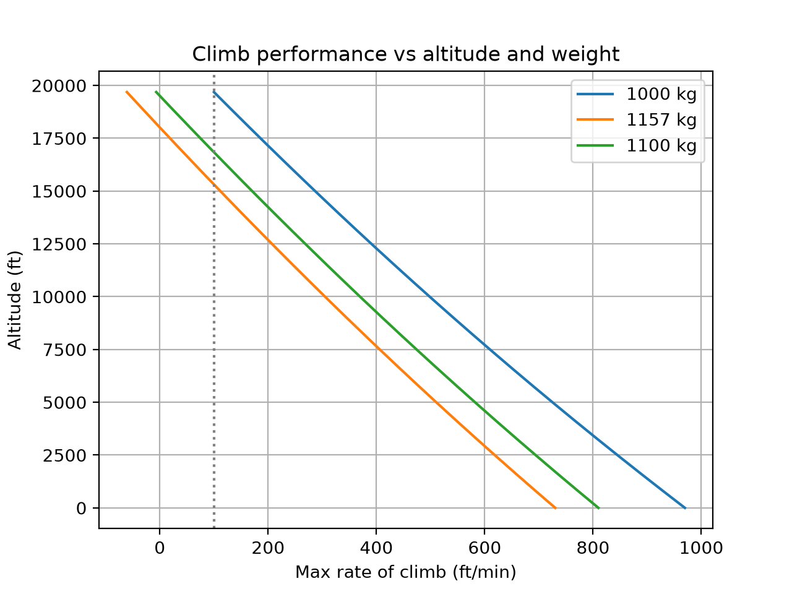
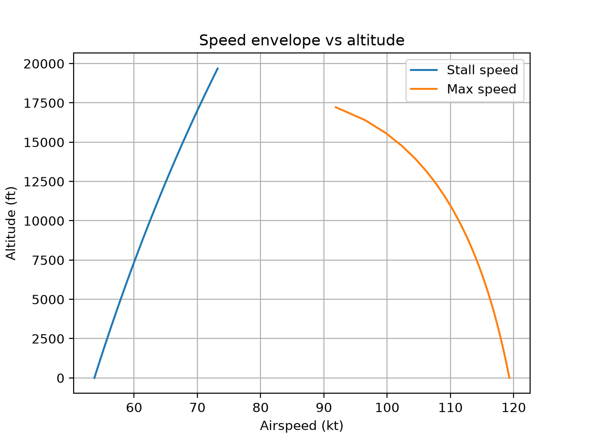

## Baseline validation (untuned)

```
Quantity                           Model       POH   Error %
Stall speed, clean (kt)             53.7      51.0      +5.3
Max speed, sea level (kt)          138.7     126.0     +10.1
Max climb rate, SL (ft/min)       1312.7     730.0     +79.8
Service ceiling (ft)             23024.6   14000.0     +64.5
Max range w/ reserve (nm)          901.2     638.0     +41.3
```

## Test 1

0.55 is below what a real prop achieves at cruise (about 0.75-0.80), so treat it as an effective value that also absorbs the optimistic power lapse and installation losses.

Climb matches while max speed is 5% low. That tension is the limit of a constant efficiency, because a real fixed-pitch prop gets more efficient as speed rises. A speed-dependent efficiency would be the physically correct fix, and it’s a good “future improvements” item.

Range is proportional to prop_eff divided by BSFC. Since BSFC was a guess, the −2.9% is partly luck from errors cancelling. Say so rather than presenting it as a clean win

Validate again ---
Quantity                           Model       POH   Error %
Stall speed, clean (kt)             53.7      51.0      +5.3
Max speed, sea level (kt)          119.3     126.0      -5.3
Max climb rate, SL (ft/min)        730.3     730.0      +0.0
Service ceiling (ft)             15311.0   14000.0      +9.4
Max range w/ reserve (nm)          619.6     638.0      -2.9

#----------
# Cessna 172S Performance Simulator: Technical Report

## 1. Objective

Build a first-principles Python model of Cessna 172S performance and check
it against published POH data. The model predicts stall speed, maximum
speed, rate of climb, service ceiling, and range/endurance across altitude,
weight, and airspeed.

## 2. Assumptions

- ISA atmosphere, troposphere only (0 to 11 km)
- Clean configuration (no flaps), gross weight 2550 lb unless varied
- Parabolic drag polar: `CD = CD0 + CL^2 / (pi * e * AR)`, with CD0 = 0.027
  and e = 0.75 (both estimates)
- CL_max = 1.5 (estimate)
- 180 hp at sea level; engine power scales with density ratio (rho / rho0)
- Constant propeller efficiency (tuned, see Section 5)
- 53 gal usable fuel (318 lb), constant BSFC of 0.45 lb/hp/hr (estimate)
- Incompressible flow (Mach below about 0.2)

## 3. Model

| Module | Purpose |
|---|---|
| `atmosphere.py` | ISA temperature, pressure, density, speed of sound |
| `aircraft.py` | 172S parameters (SI units internally) |
| `aero.py` | Lift coefficient, drag polar, L/D |
| `propulsion.py` | Power and thrust available |
| `performance.py` | Stall, max speed, climb, ceiling, range, endurance |
| `validate.py` | Comparison against POH data |

Key relations:
- Level flight: `CL = 2W / (rho V^2 S)`
- Power required = drag x velocity; power available = P_sea_level x (rho/rho0) x prop efficiency
- Rate of climb = (power available - power required) / weight, at the minimum-power speed
- Max speed: where power available equals power required (root-finding)
- Service ceiling: altitude where max rate of climb falls to 100 ft/min
- Range and endurance: propeller Breguet equations (best L/D for range, minimum power for endurance)

Each module has unit tests (hand-checkable values, expected trends); all 18 pass.

## 4. Reference data

From the 172S POH specifications: max speed 126 kt at sea level, climb
730 ft/min at sea level, service ceiling 14,000 ft, range 638 nm (45%
power, 10,000 ft, 45 min reserve), clean stall 51 KIAS.

Caveats: the stall value comes from a secondary source and should be
checked against the POH Section 5 stall table. POH max speed assumes speed
fairings. The model outputs true airspeed and the POH uses calibrated
airspeed; they are equal at sea level.

## 5. Results

### Baseline (untuned, propeller efficiency 0.80)

```
Quantity                           Model       POH   Error %
Stall speed, clean (kt)             53.7      51.0      +5.3
Max speed, sea level (kt)          138.7     126.0     +10.1
Max climb rate, SL (ft/min)       1312.7     730.0     +79.8
Service ceiling (ft)             23024.6   14000.0     +64.5
Max range w/ reserve (nm)          901.2     638.0     +41.3
```

The untuned model is optimistic on every performance measure.

### Tuning

I swept CD0 from 0.027 to 0.036 and propeller efficiency from 0.55 to 0.80.
Sea-level climb rate changes only a few percent across the CD0 range but
changes strongly with propeller efficiency, so only efficiency was tuned.
Efficiency = 0.55 matches the POH climb rate. CD0 stayed at 0.027.

### After tuning (propeller efficiency 0.55)

```
PASTE YOUR python -m src.validate OUTPUT HERE
```

Errors: stall +5.3%, max speed -5.3%, climb 0.0% (tuned), ceiling +9.4%,
range -2.9%.





## 6. Discussion

- **Trends are right.** Power available falls with altitude, climb rate
  falls with altitude and weight, and the speed envelope closes toward the
  ceiling, all as expected physically.
- **Tuned efficiency is not physical.** A real fixed-pitch prop reaches
  roughly 0.75 to 0.80 at cruise. The value 0.55 is an effective number
  that also absorbs the optimistic power lapse and installation losses.
- **Climb and top speed pull in different directions.** With efficiency
  fixed, climb matches while max speed is 5% low. A real propeller becomes
  more efficient as speed rises, which a constant value cannot capture.
- **Ceiling and range are checks on model structure, not fully independent
  tests.** They were not fitted, but they depend on the same tuned
  efficiency, so their errors are not independent of the tuning.
- **Range agreement is partly luck.** Range scales with efficiency divided
  by BSFC, and BSFC is a guess, so errors may be cancelling.
- **Stall speed is 5% high.** That implies a real CL_max nearer 1.65 than
  the assumed 1.5, though the stall reference is uncertain.

## 7. Limitations

- Constant propeller efficiency and constant BSFC
- Density-ratio engine power lapse
- Estimated CD0, Oswald efficiency, and CL_max (not measured)
- Clean configuration only; no takeoff, landing, or ground effect
- Model range does not depend on altitude, while the POH figure is at 10,000 ft
- Endurance is implemented but not validated: the POH quotes endurance at a
  cruise power setting, not at minimum power

## 8. Conclusions

With one tuned parameter, the model reproduces sea-level climb rate and
predicts max speed within 5%, ceiling within 10%, and range within 3% of
POH values. It captures the main performance trends of a light piston
aircraft, and its largest errors point to specific, fixable simplifications
in the propeller and engine models.

## 9. Future improvements

- Speed-dependent propeller efficiency (propeller map or blade-element model)
- Standard piston-engine power lapse correction instead of density ratio
- Power-setting-based cruise with altitude-dependent fuel flow
- Flaps, takeoff, and landing performance
- Extend into time-dependent flight dynamics and control (Project 2)